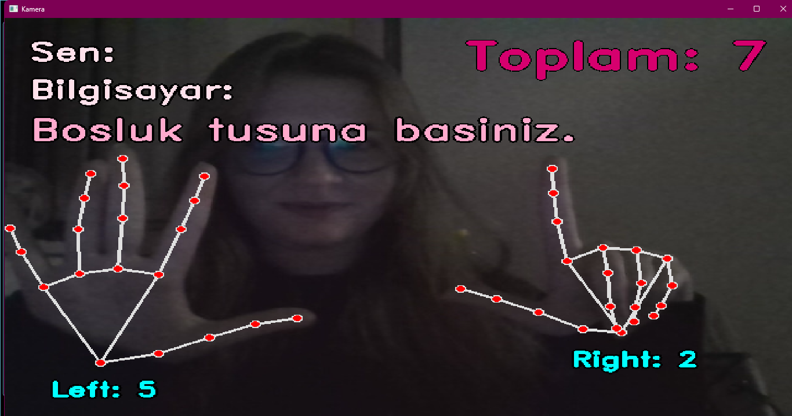
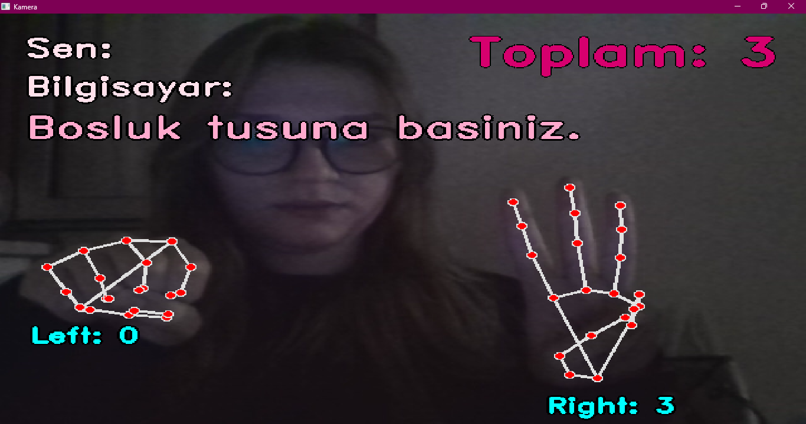
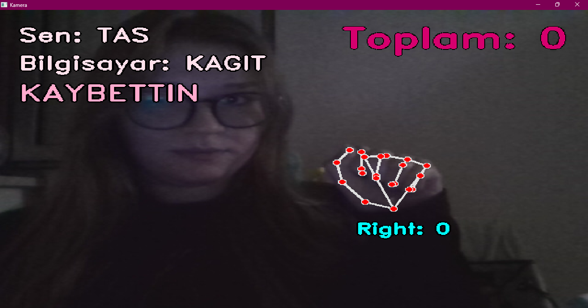
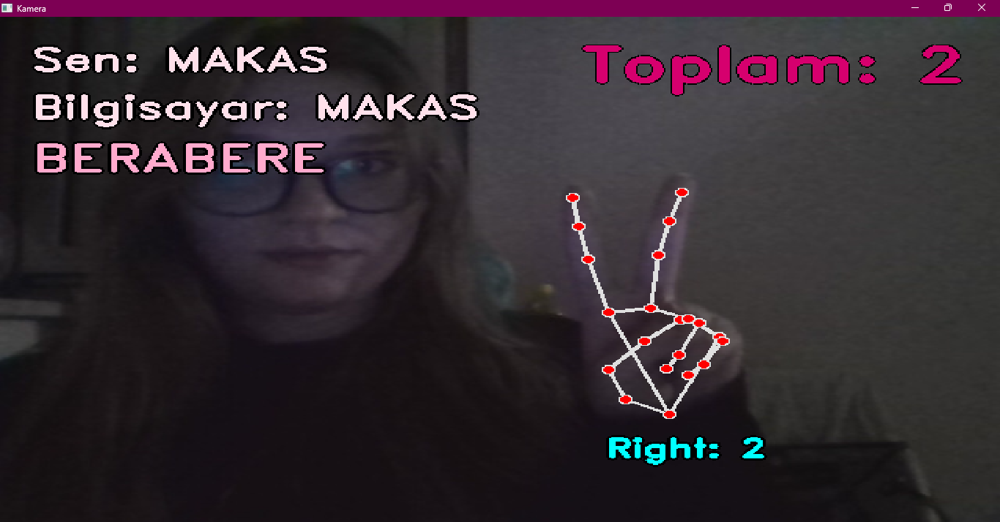
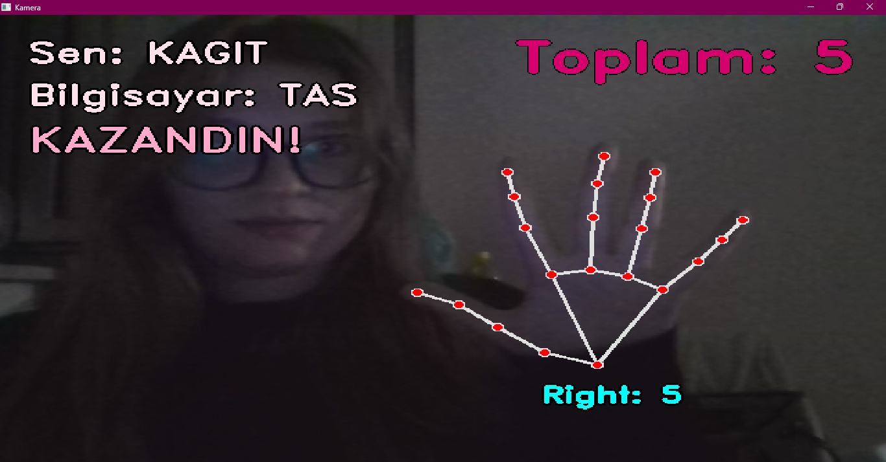

# Kamerayla El Takibi

Webcam görüntüsünden elleri algılayan, eklem noktalarını ekrana çizen ve açık parmak sayısını gösteren bir Python projesidir. İki el desteklenir, yani en fazla 10 parmak sayılabilir. Bonus olarak parmak sayısıyla Taş-Kağıt-Makas oyunu oynanabilir.

## Program ne yapıyor?

1. **Webcam'den görüntü alır.** Kamera saniyede onlarca fotoğraf (kare) üretir. Program bir döngüyle her kareyi tek tek işler (OpenCV).
2. **Eli bulur ve noktalarını çizer.** Mediapipe kütüphanesi elin üzerinde 21 nokta bulur (parmak uçları, eklemler, bilek). Bu noktalar çizgilerle birlikte ekrana çizilir. Mediapipe hazır bir modeldir, projede yeniden eğitilmemiştir, sadece kullanılmıştır.
3. **Açık parmakları sayar.**
   - İşaret, orta, yüzük ve serçe parmağında: parmağın ucu, alt ekleminden daha yukarıdaysa parmak açık sayılır. Ekranda y değeri yukarıdan aşağı doğru arttığı için "yukarıda" demek "y değeri daha küçük" demektir.
   - Başparmak yukarı değil yana açıldığı için onda y yerine x koordinatına bakılır. Sağ ve sol elde yön ters olduğu için iki el ayrı kontrol edilir.
4. **Sonucu ekrana yazar.** Her elin sayısı bileğinin yanında, toplam sayı sağ üst köşede görünür.

## Bonus: Taş-Kağıt-Makas

Parmak sayısı hamleye çevrilir:

- 0 parmak (yumruk): Taş
- 2 parmak (işaret ve orta): Makas
- 5 parmak (açık el): Kağıt

Hamle yapıldıktan sonra Boşluk tuşuna basılır. Bilgisayar rastgele bir hamle seçer, iki hamle karşılaştırılır ve sonuç (KAZANDIN, KAYBETTIN, BERABERE) ekranın sol üstüne yazılır.

## Nasıl çalıştırılır?

Python 3.12 gerekir (Mediapipe bu sürümle sorunsuz çalışmaktadır).

```
py -3.12 -m pip install -r requirements.txt
py -3.12 kamera.py
```

Çıkmak için q tuşuna basılır ya da pencere kapatılır.

## Ekran görüntüleri







## Kullanılan teknolojiler

- Python 3.12
- OpenCV (kamera, görüntü ve yazı çizimi)
- Mediapipe 0.10.14 (el algılama)

## Geliştirme sırasında karşılaşılan sorunlar

- **Python 3.14'te kurulum hata verdi.** Kütüphaneler çok yeni sürümlere henüz uyum sağlamamıştı, bu yüzden Python 3.12 kullanıldı.
- **`mp.solutions` hatası.** Mediapipe'ın en yeni sürümünde bu yapı kaldırılmış. Çalışan eski sürüm olan 0.10.14 kuruldu (numpy da 2'den küçük olmalı).
- **Görüntü ters görünüyordu.** `cv2.flip` ile aynalanarak düzeltildi.
- **Çarpıya basınca pencere geri açılıyordu.** Döngü devam ettiği için `imshow` pencereyi yeniden açıyordu. Pencerenin görünür olup olmadığı kontrol edilerek döngü bitirildi.
- **`random is not defined` hatası.** `import random` satırı eksikti, eklenerek çözüldü.

## Bilinen sınırlamalar

- El yan dönünce ya da baş aşağı tutulunca sayım şaşabilir.
- Başparmak kontrolü, avuç içi kameraya dönükken en doğru çalışır.
- OpenCV Türkçe karakterleri (ş, ı, ğ vb.) çizemediği için ekrandaki yazılar Türkçe karaktersizdir.
- Işık azken el zor algılanır.
